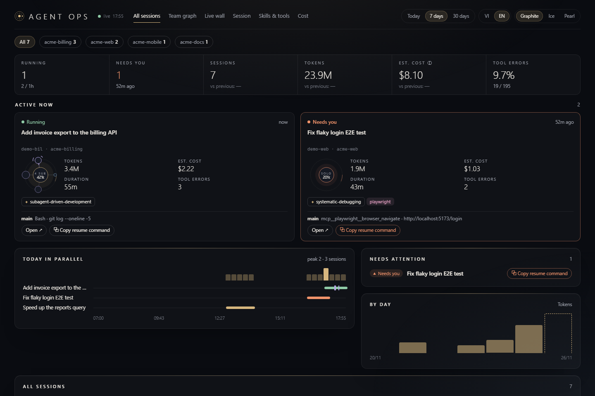
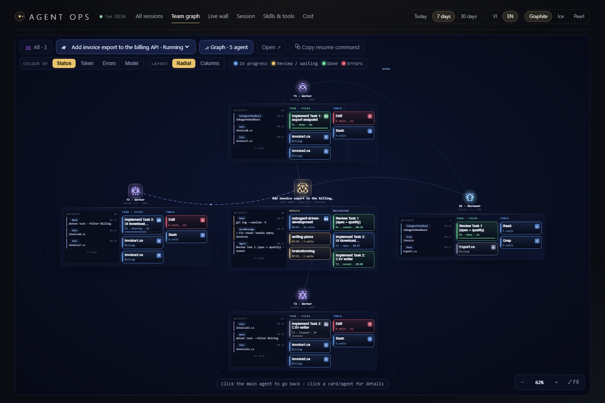
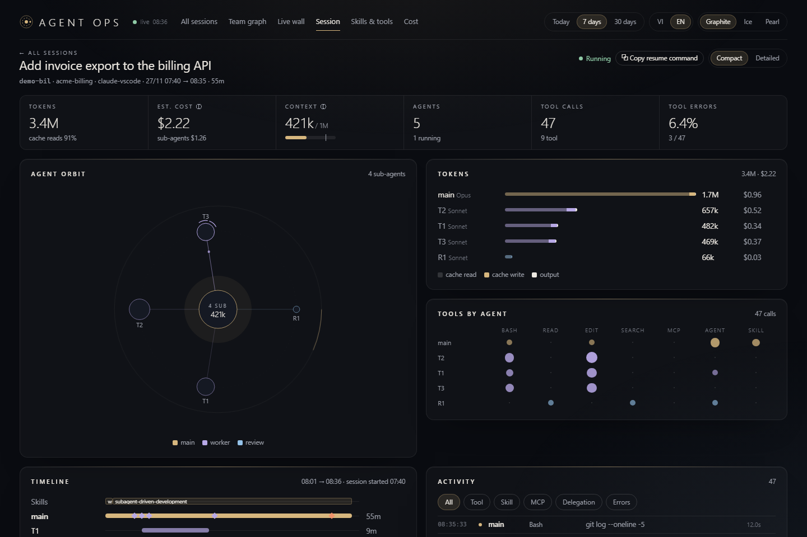
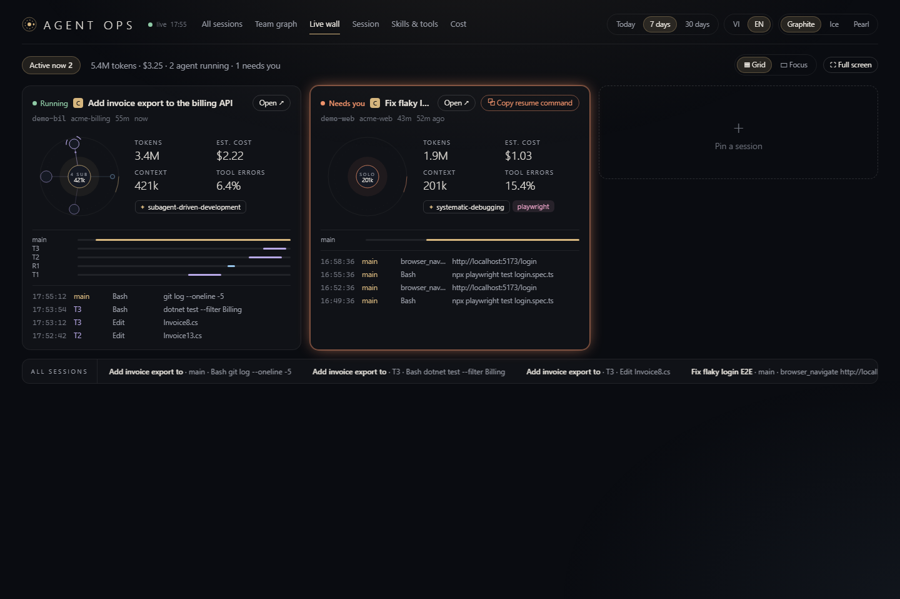
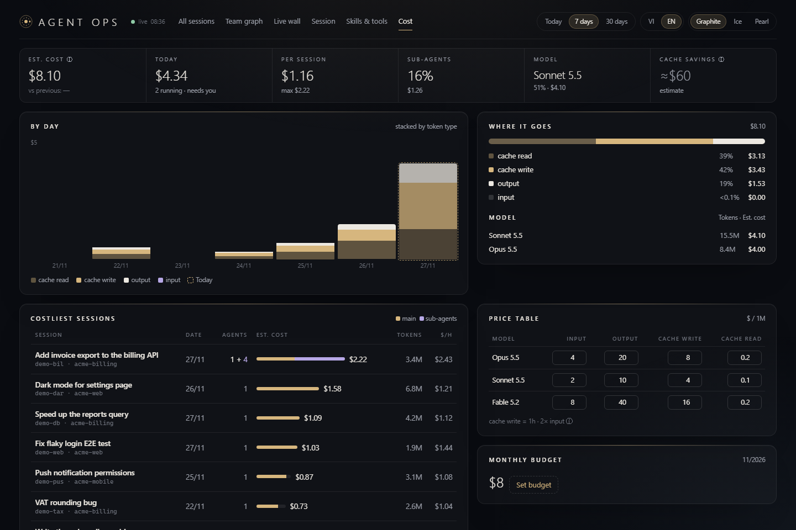

# Agent Ops

[English](#english) · [Tiếng Việt](#tiếng-việt)

## English

Agent Ops is a dashboard that runs on your own machine (localhost). It reads Claude Code session logs to show how agents coordinate, which skills and tools they use, and how many tokens they spend.



| Team graph | Session |
|---|---|
|  |  |
| **Live wall** | **Cost** |
|  |  |

<sub>Screenshots use synthetic demo data (`node scripts/demo.js`).</sub>

### Install

- **Claude Code plugin** (`/agent-ops` command):

  ```
  /plugin marketplace add ha0vn/agents-ops
  /plugin install agents-ops@agents-ops
  ```
- **Manual** (Node.js >= 20, no dependencies to install):

  ```sh
  git clone https://github.com/ha0vn/agents-ops && cd agents-ops
  node bin/agent-ops.js --open
  ```

### Usage

Run `/agent-ops` in Claude Code (it may appear as `/agents-ops:agent-ops`), or `npm start`; both start the server and open the browser at `http://127.0.0.1:4317`. If that port is busy the server uses the next free one, and a second launch finds the running instance (checks the port and the next 10) and reuses it. The browser opens on every launch unless you pass `--no-open`. The UI is available in Vietnamese and English.

### Configuration

`~/.agent-ops/config.json` (override the directory with `AGENT_OPS_HOME`): per-model prices, alert thresholds, budgets, port (default `4317`). Edits to the file need a restart (changes made in the UI apply live). Example:

```json
{
  "port": 4317,
  "budget": null,
  "thresholds": { "runMinutes": 2, "waitHours": 3, "errRate": 0.03, "ctxRatio": 0.8 },
  "prices": { "claude-opus-5-5": { "in": 4, "out": 20, "cw": 8, "cr": 0.2 } }
}
```

### Privacy

- Read-only access to Claude Code logs (`$CLAUDE_CONFIG_DIR/projects` or `~/.claude/projects`); nothing there is written or modified.
- The server listens on `127.0.0.1` only.
- Emails, tokens and secrets are masked before display.
- No network calls with your data, no telemetry.

### Supported sources

| Source | Status |
|---|---|
| Claude Code | ✔ |
| Codex CLI | planned |
| Gemini CLI | planned |
| Cursor | planned |
| VS Code Copilot | planned |
| Antigravity | planned |

### Development

```sh
npm test
```

License: MIT.

Try it without real logs: `node scripts/demo.js` (writes fake sessions to a temp folder and serves them on port 4399; it refuses to start if that port is already taken).

---

## Tiếng Việt

Agent Ops là bảng giám sát chạy trên máy bạn (localhost), đọc log phiên Claude Code để cho thấy các agent phối hợp thế nào, đang dùng skill/công cụ gì và tốn bao nhiêu token.

Xem ảnh minh hoạ ở phần English phía trên.

### Cài

- **Plugin Claude Code** (lệnh `/agent-ops`):

  ```
  /plugin marketplace add ha0vn/agents-ops
  /plugin install agents-ops@agents-ops
  ```
- **Chạy tay** (cần Node.js >= 20, không cần cài thư viện):

  ```sh
  git clone https://github.com/ha0vn/agents-ops && cd agents-ops
  node bin/agent-ops.js --open
  ```

### Dùng

Mở `/agent-ops` trong Claude Code (lệnh có thể hiện là `/agents-ops:agent-ops`), hoặc chạy `npm start`; cả hai khởi động server và mở trình duyệt tại `http://127.0.0.1:4317`. Cổng bận thì dùng cổng trống kế tiếp; lần chạy thứ hai tự tìm bản đang chạy (cổng đó và 10 cổng sau) và dùng lại. Trình duyệt mở ở mọi lần chạy, trừ khi thêm `--no-open`. Giao diện có tiếng Việt và tiếng Anh.

### Cấu hình

Tệp `~/.agent-ops/config.json` (đổi thư mục bằng biến `AGENT_OPS_HOME`): giá theo model, ngưỡng cảnh báo, ngân sách, cổng (mặc định `4317`). Sửa tay tệp này cần khởi động lại (chỉnh trong giao diện thì áp dụng ngay). Ví dụ:

```json
{
  "port": 4317,
  "budget": null,
  "thresholds": { "runMinutes": 2, "waitHours": 3, "errRate": 0.03, "ctxRatio": 0.8 },
  "prices": { "claude-opus-5-5": { "in": 4, "out": 20, "cw": 8, "cr": 0.2 } }
}
```

### Quyền riêng tư

- Chỉ đọc log Claude Code (`$CLAUDE_CONFIG_DIR/projects` hoặc `~/.claude/projects`), không ghi hay sửa gì ở đó.
- Server chỉ nghe `127.0.0.1`.
- Che email, token, khoá bí mật trước khi hiển thị.
- Không gửi dữ liệu ra mạng, không telemetry.

### Nguồn hỗ trợ

| Nguồn | Trạng thái |
|---|---|
| Claude Code | ✔ |
| Codex CLI | dự kiến |
| Gemini CLI | dự kiến |
| Cursor | dự kiến |
| VS Code Copilot | dự kiến |
| Antigravity | dự kiến |

### Phát triển

```sh
npm test
```

Giấy phép: MIT.

Chạy thử không cần log thật: `node scripts/demo.js` (tạo phiên giả trong thư mục tạm, phục vụ ở cổng 4399; từ chối chạy nếu cổng đó đã bị chiếm).
